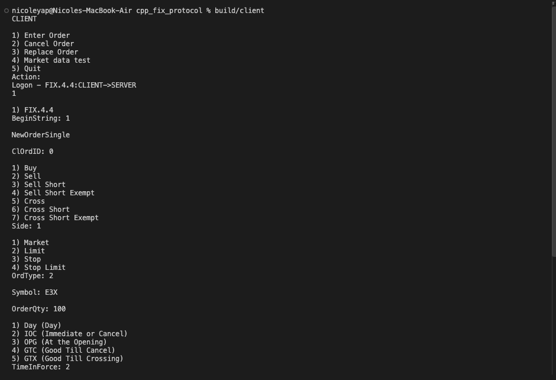
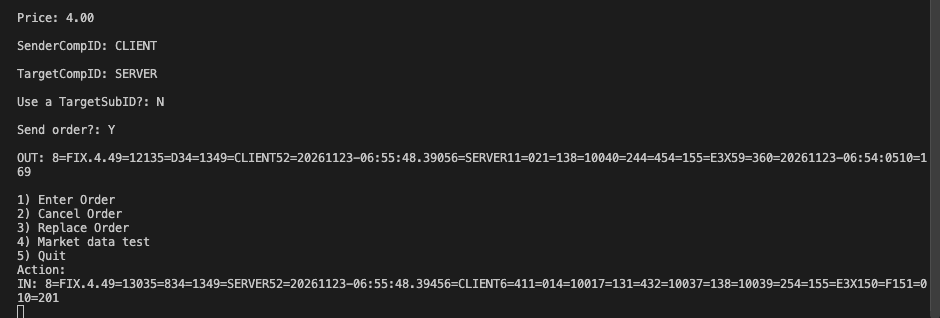

# Introduction 

This is a learning project for the FIX protocol. It contains a simple C++ server and client that exchange FIX 4.4 messages using QuickFIX.


This is a learning project for the FIX protocol. It contains a simple C++ server and client that exchange FIX 4.4 messages using [QuickFIX/C++](https://github.com/quickfix/quickfix).

**Background reading:** [What is the FIX protocol?](https://developers.redhat.com/articles/2022/02/01/build-fix-engine-using-quickfixj-and-quarkus#what_is_the_fix_protocol_) (Red Hat Developer)

**Credits:** the code is adapted from QuickFIX's [examples](https://github.com/quickfix/quickfix/tree/master/examples):
- Server: based on `executor`
- Client: based on `tradeclient`


# Building and Running the Application 

In terminal at directory cpp_fix_protocol, run: 

```bash 
cmake --build build 
```

In separate terminals, run: 

```bash
build/client 
```

and

```bash
build/server
```

# Client: Placing a NewOrderSingle

1. Choose the choice at every step. 
2. For FIX version, choose FIX 4.4 (which will show as the only choice aka choice no. 1)
3. For NewOrderSingle, add the ClOrdID (Client Order ID)
4. Create a Buy 
5. At Limit price
6. Symbol: E3X
7. OrderQty: 100
8. Immediate or Cancel 
9. Price: 4.00
10. SenderCompID: CLIENT
11. TargetCompID: SERVER


The client prints the messages it sends (`OUT:`) and receives (`IN:`). The terminal hides the separator between fields (the invisible `SOH` character, 0x01), so the fields appear joined together:

```
OUT: 8=FIX.4.49=12135=D34=1349=CLIENT52=20261123-06:55:48.39056=SERVER11=021=138=10040=244=454=155=E3X59=360=20261123-06:54:0510=169

IN: 8=FIX.4.49=13035=834=1349=SERVER52=20261123-06:55:48.39456=CLIENT6=411=014=10017=131=432=10037=138=10039=254=155=E3X150=F151=010=201
```





# Reading a FIX message (with help of Claude)

A message is a list of `tag=value` fields. **Read tag 35 (`MsgType`) first**, because it says what kind of message it is. Common values: `A` Logon, `0` Heartbeat, `5` Logout, `D` NewOrderSingle, `8` ExecutionReport, `3` Reject.

## OUT: the order the client sent (`35=D`, NewOrderSingle)

| Tag | Name | Value | Meaning |
|---|---|---|---|
| 8 | BeginString | `FIX.4.4` | Protocol version |
| 9 | BodyLength | `121` | Bytes from `35=` to the end of the last field before `10=` |
| 35 | MsgType | `D` | NewOrderSingle |
| 34 | MsgSeqNum | `13` | The client's 13th message in this session |
| 49 | SenderCompID | `CLIENT` | From |
| 52 | SendingTime | `20261123-06:55:48.390` | When it was sent (UTC) |
| 56 | TargetCompID | `SERVER` | To |
| 11 | ClOrdID | `0` | The client's ID for this order |
| 21 | HandlInst | `1` | Automated execution, no human intervention |
| 38 | OrderQty | `100` | Quantity |
| 40 | OrdType | `2` | Limit |
| 44 | Price | `4` | Limit price |
| 54 | Side | `1` | Buy |
| 55 | Symbol | `E3X` | The instrument |
| 59 | TimeInForce | `3` | Immediate or Cancel |
| 60 | TransactTime | `20261123-06:54:05` | When the order was created |
| 10 | CheckSum | `169` | Sum of all bytes before it, modulo 256 |

In words: *buy 100 E3X as a limit order at 4, fill what you can right now and cancel the rest.*

## IN: the server's reply (`35=8`, ExecutionReport)

| Tag | Name | Value | Meaning |
|---|---|---|---|
| 8, 9 | BeginString, BodyLength | `FIX.4.4`, `130` | Version, length |
| 35 | MsgType | `8` | ExecutionReport |
| 34 | MsgSeqNum | `13` | The server's 13th message (its own counter) |
| 49 / 56 | SenderCompID / TargetCompID | `SERVER` / `CLIENT` | Reversed from the order |
| 52 | SendingTime | `20261123-06:55:48.394` | 4 ms after the order |
| 11 | ClOrdID | `0` | Echoes the client's ID, so the client can match the reply |
| 37 | OrderID | `1` | The server's own ID for the order |
| 17 | ExecID | `1` | ID of this execution |
| 39 | OrdStatus | `2` | Filled |
| 150 | ExecType | `F` | Trade |
| 14 | CumQty | `100` | Total filled so far |
| 151 | LeavesQty | `0` | Quantity still unfilled |
| 32 | LastQty | `100` | Quantity of this fill |
| 31 | LastPx | `4` | Price of this fill |
| 6 | AvgPx | `4` | Average fill price |
| 38, 54, 55 | OrderQty, Side, Symbol | `100`, `1`, `E3X` | The order details, echoed back |
| 10 | CheckSum | `201` | |

In words: *order 0 is filled, 100 at 4, nothing left.*


